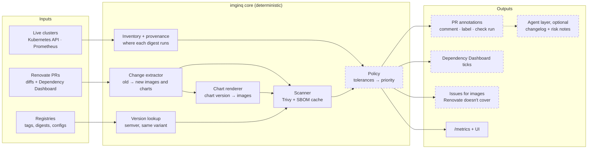

# image-inquisitor Roadmap

_As of 2026-11-04_

This page lists what's left to build. What already works is documented in the [docs](README.md).

## Vision

imginq tells you which image updates matter. For each Renovate PR it shows the CVEs the bump fixes or introduces, and where the old version is running.

- **What sets it apart:** the old-vs-new CVE diff, weighted by live usage across clusters. Renovate's vulnerability alerts cover package advisories, not container image scans.
- **Where results show up:** mainly as comments, labels and checks on the Renovate PRs you already get. Reports and metrics come second.
- **Scope:** homelab first (Argo CD, a mix of third-party and self-built images). Designed so it also works at work: GitHub App auth, several clusters.

## Principles

1. **Don't reinvent.** Renovate finds and edits the files. Trivy does the scanning. Argo CD knows what is deployed and from where. imginq connects them.
2. **Deterministic core.** Inventory, scanning, diffing, version lookup and policy are plain code, so a priority is reproducible and auditable.
3. **Agents are optional.** LLM steps add narrative (changelog risk, CVE relevance) on top of structured results and never set labels. The tool is fully useful without them.
4. **Scan by digest, cache aggressively.** A digest never changes; only the vulnerability database does. Generate an SBOM once per digest, then re-check it against the current database.
5. **Provenance from day one.** Every image keeps where it was found: cluster, namespace, owner, Argo CD app, repo.

## Target architecture

Dashed boxes aren't built yet.

The service mode (daemon + UI) exists. Still planned is a **GitHub Action** mode from the same core: `imginq annotate-pr` runs on Renovate PRs with nothing to deploy, and an optional Prometheus URL adds live-usage data.

## What's left

### Next

- [ ] Try daemon-run Renovate against the real repos (first with `dryRun: full`), then suspend the separate Renovate CronJob

### Phase 1 · Annotate Renovate PRs

Done when it runs on real Renovate PRs in the Argo CD repo.

- [ ] Post results to the PRs: one comment kept up to date in place (CVEs fixed and introduced by severity, where the old version runs) and a severity label; optionally a check run
- [ ] Comments on Dockerfile `FROM` bumps say "base image": base-image CVEs aren't your image's CVEs
- [ ] `imginq annotate-pr` as a GitHub Action, caching the Trivy DB between runs

### Phase 2 · Helm chart bumps

Chart PRs already show their image changes in the UI. Done when chart PRs get the same comment as image PRs.

- [ ] Render Kustomize and plain-manifest Argo CD sources (only Helm sources are rendered)
- [ ] Read git charts and value files from hosts other than GitHub
- [ ] Apps that deploy to a cluster other than the one they're defined in
- [ ] Attribute images an operator sets by default (not from its custom resource)
- [ ] Extract more diff shapes: split `repository:` / `tag:` values (common in third-party charts) and Kustomize `images:`
- [ ] Scan the images a newer chart version would bring in before a PR exists

### Phase 3 · Scanning

- [ ] Scan platforms other than linux/amd64, and build the images for them (both are amd64 only)

### Phase 4 · Live inventory

Done when PRs are ranked by live usage.

- [ ] Prometheus as an inventory source (`kube_pod_container_info` joined with `kube_pod_owner`)
- [ ] Ignore managed resources (e.g. GKE/EKS system workloads) by label or annotation
- [ ] Scan CronJob templates that have no running digest
- [ ] Registry auth beyond Docker credentials, and handling Docker Hub rate limits

### Phase 5 · Policy + Dependency Dashboard

Done when urgent updates open on their own.

- [ ] A policy file with tolerances that drives labels and the check run (e.g. block automerge when criticals are introduced)
- [ ] Scoring and weighting of image priority
- [ ] Configurable CVE SLAs (fixed at 7/30/90/180 days in `internal/api/trends.go`)
- [ ] Tick Dependency Dashboard boxes for pending updates over the threshold

### Phase 6 · Coverage gaps

- [ ] Open issues for running images no Renovate PR covers, mapped to a repo via Argo CD tracking annotations
- [ ] GitHub App auth alongside a PAT

### Phase 7 · Optional agent layer

Done when comments explain upgrade risk, not just counts. Triggered only above the policy threshold, possibly via `anthropics/claude-code-action`.

- [ ] Changelog risk summary on PRs (first)
- [ ] CVE relevance notes
- [ ] Renovate `customManagers`/`packageRules` for coverage gaps
- [ ] Fix-build PRs for self-built images

### Renovate soak follow-ups

- [ ] Date more than the newest version: other updates Renovate proposes (e.g. a minor while a major exists) keep Renovate's own soak and stay held for registries without release dates
- [ ] Handle repo `renovate.json` packageRules that override the generated ones
- [ ] Soak charts by the CVEs of their images: soak rules only match the image, so a chart-pinned image's lane does nothing and its chart keeps the default soak, even when the update fixes criticals. Needs chart release dates, and would allow a progress bar on pinned images
- [ ] Show which workloads a PR really updates, e.g. "updates 3 of 5": chart PRs map to apps, but direct image PRs need mapping from the file they change to the workloads it deploys. Until then one PR marks every workload on that tag as pending
- [ ] Hide soak badges on chart-pinned images in the Running images table and the dashboard, as the image page does
- [ ] Settle on "Fastlane" or "fast lane": the image page's Open PR panel says one, the badges the other

## Known issues

- [ ] The UI and API have no authentication; anyone who can reach them can trigger syncs and Renovate runs

## Open questions

- **Fixtures stay synthetic.** This repo is public and the target deploy repo is private, so fixtures copy the diff shapes with neutral content.
- Support a GitHub App from the start, or only a PAT until work use is real?
- Ship the Action as a reusable action in this repo, or as a container step?
